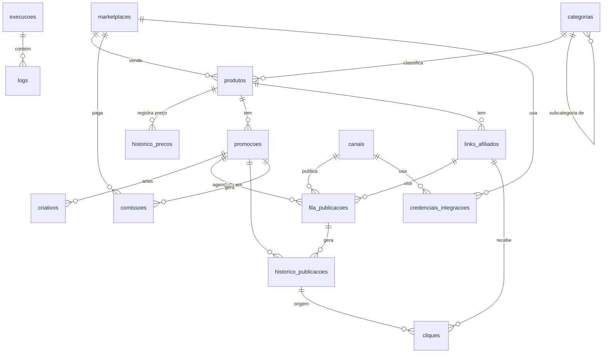

# Banco de dados: Bot de Ofertas

**Onde está:** PostgreSQL 17 no Supabase, projeto **bot-promocoes** (`tafmitwmtjbdopchycac`, São Paulo).

**Situação em 22/11/2026:**
- 18 de 18 migrations aplicadas (008b, 015 e 016 em 23/11/2026).
- **118 de 118** testes de integridade aprovados (inclui os 10 da auditoria e os 11 de cupons).
- Dados do teste de cliques e extensão `pg_net` removidos em 23/11/2026. de integridade aprovados.
- Teste de volume com 10 mil produtos aprovado.
- A estrutura antiga (v1, que estava vazia) foi removida.

## 1. Diagrama



## 2. Tabelas

| # | Tabela | Para quê | Regras principais |
|---|---|---|---|
| 1 | `administradores` | Quem acessa o painel: **dono**, **editor** ou **leitor** | O 1º cadastro vira dono. Só existe 1 dono, que não pode ser apagado nem rebaixado (só por `transferir_posse`). E-mail único. |
| 2 | `marketplaces` | Lojas (Shopee, Mercado Livre, Demo) | Código único. `dominios_afiliado` válidos (sem `https://`, minúsculos). `modo`: real, demo, manual ou desativado. |
| 3 | `credenciais_integracoes` | Metadados das chaves de API | **O valor fica cifrado no Supabase Vault.** A tabela guarda só a dica (`••••1234`). Única por integração + nome. |
| 4 | `produtos` | Itens dos marketplaces | **Sem duplicidade:** `unique (marketplace_id, id_externo)`. Preço > 0, nota de 0 a 5. Produto de marketplace demo é marcado como `demo`. |
| 5 | `categorias` | Eletrônicos, Beleza, Casa… | Nome único (ignora maiúsculas e espaços), slug único, palavras-chave de busca. |
| 6 | `historico_precos` | Cada mudança de preço ou disponibilidade | **Automático** (gatilho) e **imutável**. Guarda a variação em %. |
| 7 | `promocoes` | As ofertas | **Sem duplicidade:** 1 promoção ativa por produto. Desconto calculado pelo banco. **Não fica "publicada" sem link de afiliado validado.** |
| 8 | `links_afiliados` | Links de afiliado | HTTPS obrigatório, URL única. Só é validado se o domínio for de afiliado do marketplace (rejeita disfarces como `afiliado.loja.com.br.golpe.com`). Se a URL mudar, a validação cai. |
| 9 | `criativos` | Artes (feed, story, Telegram) | Precisa ter URL ou caminho no storage. Sem arte repetida (mesmo hash). |
| 10 | `canais` | Telegram, Stories, Feed… | Modo real, demo ou desativado. Limite diário e intervalo mínimo por canal. Tokens **nunca** ficam aqui. |
| 11 | `fila_publicacoes` | O que vai ser publicado | Só entra oferta **aprovada**, com **link validado do mesmo produto**, em **canal ativo**. Oferta demo nunca vai para canal real. Sem duplicidade por promoção + canal. Retentativas com espera crescente (2, 4, 8 min). |
| 12 | `historico_publicacoes` | Cada tentativa de publicação | Imutável. Um sucesso marca a promoção como publicada e conclui a fila. Publicação em canal demo não marca oferta real. Erros têm tokens mascarados. |
| 13 | `cliques` | Cliques no link rastreado | IP só como hash SHA-256 com sal. O mesmo visitante não conta duas vezes em 30 s. Imutável. |
| 14 | `comissoes` | Comissões (API ou manuais) | **Sem duplicidade** da API: `unique (marketplace_id, referencia_externa)`. Paga exige data, comissão não passa do valor da venda. O painel não cria comissão "api". |
| 15 | `configuracoes` | Ajustes automáticos (horários, filtros, monitor…) | Valor validado pelo tipo e pelos limites (ex.: desconto entre 0 e 95). Registra quem alterou. |
| 16 | `execucoes` + `logs` | Logs de cada rodada do bot | Níveis DEBUG, INFO, AVISO, ERRO e CRÍTICO. **Tokens e chaves mascarados automaticamente.** Imutáveis. Apagados após 30 dias (configurável). |
| + | `auditoria` | Quem mudou o quê no painel | Automática em 9 tabelas, só para ações de pessoas. Imutável. Só o dono vê. |

**Timestamps automáticos:** toda tabela tem `criado_em`, e as tabelas editáveis têm `atualizado_em`, preenchido por gatilho.

## 3. Regras de negócio garantidas pelo próprio banco

1. **Nenhum produto é publicado sem link de afiliado validado.** A regra é conferida em 4 pontos: link, promoção, fila e histórico.
2. **Validar link e marcar como publicada são tarefas do sistema:** pelo painel isso é recusado (erros P0016 e P0017).
3. **Monitor de preço:** se o preço subir além da tolerância (5%) ou o produto ficar indisponível, a promoção é pausada e a fila é cancelada. O motivo fica registrado.
4. **Link invalidado:** a fila é cancelada e as promoções sem outro link válido são pausadas.
5. **Demo isolado:** dados de demonstração nunca chegam a canais reais.
6. **Históricos imutáveis:** preços, publicações, cliques, logs e auditoria não podem ser alterados.

## 4. Segurança

| Papel | Acesso |
|---|---|
| Visitante (anon) | **Nenhum.** Privilégios revogados, além do RLS. |
| Logado sem cadastro | Nenhum (vê 0 linhas, não grava) |
| Leitor | Lê tudo, exceto auditoria e credenciais |
| Editor | Opera ofertas, links, fila, categorias, comissões manuais e ajustes |
| Dono | Tudo: administradores, auditoria, credenciais, criar e remover marketplaces e canais |
| Backend (chave secreta) | Ignora o RLS. Só ele lê credenciais, pega a fila e registra cliques. |

- RLS ativo nas 18 tabelas. As funções de permissão ficam no schema `privado`, que não é exposto pela API.
- **Credenciais:** `salvar_credencial()` (só o dono) cifra no Vault. `obter_credencial()` só funciona com a chave secreta: o painel **nunca** recebe o valor.
- **Logs:** máscara automática para token do Telegram, `sb_secret_`, JWT, `github_pat_`, `access_token=`, `"token": "…"` e `Bearer`.
- **Avisos do advisor que ficam de propósito:** `salvar_credencial`, `remover_credencial` e `transferir_posse` podem ser chamadas por usuários logados porque conferem por dentro se quem chama é o dono. Isso foi testado.

## 5. Funções para o backend e o painel

| Função | Quem usa | O que faz |
|---|---|---|
| `meu_papel()` | painel | Papel do usuário logado |
| `transferir_posse(uuid)` | dono | Passa a posse para outro administrador |
| `salvar_credencial / remover_credencial` | dono ou backend | Grava ou apaga no Vault |
| `obter_credencial` | backend | Lê o valor decifrado |
| `registrar_clique` | função `r` | Conta o clique e devolve o destino validado |
| `pegar_proximas_publicacoes(n, min)` | worker | Pega itens da fila com `FOR UPDATE SKIP LOCKED` (vários workers sem conflito), respeitando limite diário e intervalo do canal |
| `manutencao_diaria()` | backend | Expira promoções vencidas e limpa registros antigos ⚠ *pendente, ver seção 8* |
| `vw_promocoes_painel`, `vw_metricas_diarias` | painel | Ofertas com cliques e comissão; métricas de 90 dias (respeitam o RLS) |

## 6. Desempenho (teste com 10 mil produtos)

Volume do teste: 10 mil produtos, 10 mil promoções, 10 mil links, 20 mil publicações, 50 mil cliques e 5 mil itens na fila.

| Consulta | Tempo |
|---|---|
| Achar produto pelo ID externo | 8 ms (índice único) |
| Painel: 50 ofertas recentes com cliques e comissão | **59 ms** (eram 14.860 ms antes da correção do índice) |
| Métricas de 90 dias | 8 ms |
| Worker pega 10 itens da fila | 82 ms |
| 100 produtos sobem de preço (pausa automática) | 76 ms |

Inserção em massa: cerca de 10 mil linhas a cada 2 a 4 s, com todos os gatilhos de integridade ligados.

## 7. Como aplicar e testar

- **Migrations** (`supabase/migrations/`): aplique na ordem dos nomes. Já estão aplicadas no projeto, exceto a da seção 8. Compatíveis com `supabase db push`.
- **Testes** (`supabase/tests/`): rode os arquivos `00` a `10` no SQL Editor e depois:
  ```sql
  select * from testes.resumo();        -- 118 / 118 / 0
  select * from testes.rodar();         -- detalhe de cada teste
  select * from testes.carga(10000);    -- teste de volume (desfaz tudo no final)
  ```

### Códigos de erro próprios

| Código | Significado |
|---|---|
| P0001 | Tentativa de remover ou rebaixar o dono |
| P0002 | Tentativa de alterar registro imutável |
| P0003 | Painel tentou mudar tipo ou limite de uma configuração |
| P0010 | Link de afiliado não validado |
| P0011 | Domínio não é de afiliado do marketplace |
| P0012 | Link de outro produto |
| P0013 | Promoção não aprovada |
| P0014 | Canal inativo |
| P0015 | Oferta demo em canal real |
| P0016 | Painel tentou validar link |
| P0017 | Painel tentou marcar como publicada |
| P0018 | Mesma oferta no mesmo canal dentro da janela de repetição (padrão 24 h) |
| P0019 | Oferta sem classificação "excelente" ou "boa" do motor de inteligência |
| P0020 / P0021 / P0022 | Cadastro manual: loja desativada / link sem https / produto já tem oferta ativa |
| P0023 | Painel tentou alterar pontuação ou classificação |
| P0024 | Link no domínio da loja, mas sem o formato de link de afiliado (`marketplaces.padrao_afiliado`) |
| P0025 | Cupom vencido ou pausado não pode ser publicado |
| P0026 | Produto de outra loja não pode entrar no cupom |

## 7b. Motor de inteligência (migrations 013 e 014)

- `promocoes` ganhou `pontuacao` (0–100), `classificacao` (excelente / boa / nao_recomendada), `confianca`, `analise` (explicação em JSON) e `analisada_em`. Esses campos são preenchidos juntos ou ficam todos vazios.
- Mudança de preço, disponibilidade ou link apaga a análise, e a oferta volta para o motor.
- A fila só aceita oferta excelente ou boa e recusa repetir o mesmo produto no mesmo canal dentro de `inteligencia.janela_repeticao_horas`.
- 20 regras novas em `configuracoes` (grupo `inteligencia`). Detalhes em `docs/MOTOR_INTELIGENCIA.md`.

## 7c. Correções da auditoria (migration 015)

- `marketplaces.padrao_afiliado`: formato obrigatório do link de afiliado (erro P0024).
- Fila à prova de post duplicado: `publicando_desde` é marcado antes do envio. Item vencido com essa marca vira "falhou: resultado incerto" e não é republicado.
- `fila_devolver` (volta para a fila sem gastar tentativa) e `fila_marcar_incerta`, só para o backend.
- `encerrar_execucoes_orfas`: rodada que ficou "rodando" vira "erro (interrompida)".
- A análise do motor também é apagada em oferta **publicada** quando preço, estoque ou link mudam.
- Limite diário dos stories reduzido para 45 (cota da API do Instagram: 50 em 24 h, contando o feed).
- Detalhes e testes em `docs/AUDITORIA.md`.

## 7d. Cupons e campanhas (migration 016)

- `cupons`: cupom (código) ou campanha (link de afiliado), com desconto, mínimo, teto, validade, palavras para sugestão e status (ativo, pausado, expirado). Campanhas da Shopee entram sozinhas (`origem = automatica`).
- `cupons_produtos`: produtos em que o cupom vale. Os que você adiciona entram aprovados; as sugestões do bot aguardam aprovação.
- `cupons_publicacoes`: 1 publicação com sucesso por cupom, canal e dia (índice único). Imutável.
- `vw_cupons_painel`: cupons com contagens para o painel (respeita o RLS).
- A manutenção diária também marca cupons vencidos.
- Detalhes em `docs/CUPONS.md`.

## 8. Pendências

1. **Domínios e formato de link de afiliado precisam ser confirmados** com links reais do seu painel:
   - Shopee: `s.shopee.com.br`, `shope.ee` (formato `^https://(s\.shopee\.com\.br|shope\.ee)/…`)
   - Mercado Livre: `mercadolivre.com` (formato `^https://mercadolivre\.com/sec/…`)
2. **Tudo começa em modo demo** (marketplaces e canais). O backend passa para "real" quando as credenciais forem cadastradas e testadas.
